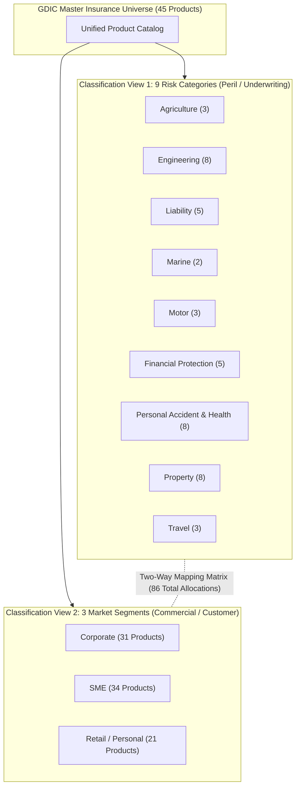
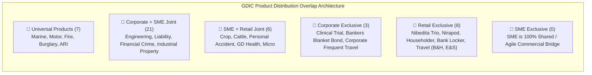

# Green Delta Insurance Company (GDIC) — Standardized Insurance Product Portfolio

> **Comprehensive Non-Life Insurance Knowledge Base & Dual-Classification Catalogue**  
> Standardized non-life insurance inventory organized across two complementary, orthogonal classification dimensions.

| Metadata Attribute | Specification / Value |
| :--- | :--- |
| **Document Title** | Insurance Product Portfolio Standardized Catalogue |
| **Underwriting Institution** | Green Delta Insurance Company Limited (GDIC) |
| **Total Unique Products** | **45 Products** |
| **Classification View 1 (Technical / Peril)** | **9 Risk Categories** |
| **Classification View 2 (Commercial / Market)** | **3 Market Segments** |
| **Total Market Allocations** | **86 Multi-Market Deployments** |
| **Classification Architecture** | Orthogonal Dual-Classification (Single Product Universe, Dual Analytical Views) |
| **Source Artifact** | GDIC_Product_Portfolio_Standardized.docx |
| **Knowledge Base Format** | GitHub Flavored Markdown (GFM) with Mermaid Diagrams & Cross-Reference Matrices |

---

## Table of Contents

- [1. Architectural Framework: The Dual-Classification System](#1-architectural-framework-the-dual-classification-system)
  - [1.1 Purpose and Underwriting Philosophy](#11-purpose-and-underwriting-philosophy)
  - [1.2 Dual Classification System Architecture Diagram](#12-dual-classification-system-architecture-diagram)
- [2. Master Product Registry & Knowledge Base](#2-master-product-registry--knowledge-base)
- [3. Category 1: Portfolio View by Risk Category](#3-category-1-portfolio-view-by-risk-category)
  - [3.1 Agriculture (3 Products)](#31-agriculture-3-products)
  - [3.2 Engineering (8 Products)](#32-engineering-8-products)
  - [3.3 Liability (5 Products)](#33-liability-5-products)
  - [3.4 Marine (2 Products)](#34-marine-2-products)
  - [3.5 Motor (3 Products)](#35-motor-3-products)
  - [3.6 Financial Protection (5 Products)](#36-financial-protection-5-products)
  - [3.7 Personal Accident & Health (8 Products)](#37-personal-accident--health-8-products)
  - [3.8 Property (8 Products)](#38-property-8-products)
  - [3.9 Travel (3 Products)](#39-travel-3-products)
- [4. Category 2: Portfolio View by Market Segment](#4-category-2-portfolio-view-by-market-segment)
  - [4.1 Corporate Portfolio (31 Products)](#41-corporate-portfolio-31-products)
  - [4.2 SME (Small & Medium Enterprises) Portfolio (34 Products)](#42-sme-small--medium-enterprises-portfolio-34-products)
  - [4.3 Retail / Personal Portfolio (21 Products)](#43-retail--personal-portfolio-21-products)
  - [4.4 Source Document Reconciliation Note (Trailing Agriculture Block)](#44-source-document-reconciliation-note-trailing-agriculture-block)
- [5. Two-Way Cross-Classification Mapping Matrix](#5-two-way-cross-classification-mapping-matrix)
- [6. Portfolio Analytics & Distribution Statistics](#6-portfolio-analytics--distribution-statistics)
  - [6.1 9x3 Risk Category by Market Segment Cross-Tabulation](#61-9x3-risk-category-by-market-segment-cross-tabulation)
  - [6.2 Market Segment Overlap & Exclusivity Analysis](#62-market-segment-overlap--exclusivity-analysis)
- [7. AI Knowledge Base Query Guide & Retrieval Heuristics](#7-ai-knowledge-base-query-guide--retrieval-heuristics)
  - [7.1 Commercial Persona Routing Rules](#71-commercial-persona-routing-rules)
  - [7.2 Product Code Disambiguation Reference](#72-product-code-disambiguation-reference)

---

## 1. Architectural Framework: The Dual-Classification System

### 1.1 Purpose and Underwriting Philosophy

In non-life insurance management, product cataloguing requires structuring along two distinct operational axes:

1. **The Technical & Underwriting Perspective (Risk Category):** Groups products by the nature of the underlying peril, insurable interest, policy drafting conventions, actuarial loss profiling, and reinsurance treaty treaties (e.g., Fire, Marine, Engineering, Liability).
2. **The Commercial & Distribution Perspective (Market Segment):** Groups products by customer persona, enterprise scale, risk retention appetite, purchasing behavior, and distribution channels (Corporate conglomerates, SME businesses, and Retail / Personal consumers).

> [!IMPORTANT]
> **Unified Product Universe, Dual Views:** These two classification structures do **not** represent separate or conflicting sets of products. Instead, they provide **two complementary, synchronized views of the exact same 45 products**. Every product belongs to **exactly one Primary Risk Category** (its technical identity), and is simultaneously available across **one, two, or all three Market Segments** (its commercial availability).

### 1.2 Dual Classification System Architecture Diagram

---

## 2. Master Product Registry & Knowledge Base

The Master Registry below serves as the canonical knowledge base of all 45 unique non-life insurance products offered by Green Delta Insurance Company. Each product is cataloged once with complete underwriting attributes, preventing unnecessary duplication while providing rich semantic context for AI inference and automated query routing.

| # | Product Name | Code | Primary Risk Category | Market Segments | Underwriting Scope & Covered Perils | Target Insured / Commercial Application |
| :---: | :--- | :---: | :--- | :--- | :--- | :--- |
| 1 | **Crop Insurance** | WII | Agriculture | SME, Retail / Personal | Weather Index-based Insurance (WII) designed to protect smallholder farmers, agribusinesses, and farming cooperatives against agricultural yield losses caused by weather anomalies, including prolonged drought, excess precipitation, unseasonal temperature spikes, and localized flooding. | Individual farmers, agricultural SMEs, contract farming enterprises, and microfinance agrarian borrowers. |
| 2 | **Rubber Plantation Insurance** | RPI | Agriculture | Corporate, SME | Specialized perennial crop insurance indemnifying commercial plantation owners against tree mortality, plantation destruction, and latex yield loss caused by natural catastrophes (cyclones, windstorms, lightning, flood) and fire hazards. | Commercial rubber plantation corporations, agro-forestry estates, state agricultural enterprises, and medium-scale growers. |
| 3 | **Cattle Insurance** | LCI | Agriculture | SME, Retail / Personal | Livestock and Cattle Insurance (LCI) covering financial capital loss resulting from the accidental death, terminal illness, disease epidemics, calving mortality, or permanent incapacity of dairy cows, breeding stock, and beef fattening cattle. | Smallholder dairy farmers, commercial livestock feedlots, rural cattle owners, and microcredit-financed cattle rearing projects. |
| 4 | **Boiler Pressure Vessel** | BPV | Engineering | Corporate, SME | Covers sudden physical explosion or collapse of industrial steam boilers, pressure plant vessels, and piping networks during active operation, extending indemnity to surrounding property damage and third-party legal liabilities. | Textile & RMG manufacturing mills, chemical plants, pharmaceutical manufacturers, food processing factories, and thermal utilities. |
| 5 | **Contractor's All Risks** | CAR | Engineering | Corporate, SME | Comprehensive all-risk insurance for civil construction works (commercial buildings, highway infrastructure, bridges, drainage networks) against accidental physical damage, natural calamities, collapse, and third-party property/bodily injury liabilities. | General building contractors, civil engineering firms, property developers, infrastructure consortia, and government project authorities. |
| 6 | **Contractor's Plant & Machinery Insurance** | CPM | Engineering | Corporate, SME | Protects heavy civil contractor mobile equipment, stationary plant, excavators, tower cranes, earth-moving machinery, and concrete batching units against accidental overturning, collision, site collapse, fire, theft, and malicious damage. | Equipment leasing companies, civil construction contractors, earthworks operators, and mining/quarry enterprises. |
| 7 | **Deterioration of Stock** | DOS | Engineering | Corporate, SME | Specialized consequential loss cover insuring refrigerated perishable inventories (potatoes, seed stock, fresh produce, frozen fish, poultry, pharmaceuticals) against spoilage or decay caused by sudden mechanical breakdown of refrigeration plant. | Cold storage operators, agricultural warehousing hubs, seafood/meat processors, and temperature-controlled pharmaceutical warehouses. |
| 8 | **Erection All Risks** | EAR | Engineering | Corporate, SME | All-risk project cover for the mechanical, electrical, and structural installation, erection, alignment, testing, and commissioning of heavy industrial machinery, manufacturing lines, substations, and industrial manufacturing plants. | EPC contractors, industrial plant developers, mechanical & electrical engineering firms, power plant constructors, and equipment vendors. |
| 9 | **Electronic Equipment Insurance** | EEI | Engineering | Corporate, SME | All-risk policy for delicate electronic hardware (enterprise servers, mainframe computers, medical diagnostic scanners, telecommunications gear, broadcasting equipment) against sudden electrical breakdown, voltage surges, user error, and water ingress. | IT & software companies, corporate data centers, telecommunication service providers, diagnostic clinics, hospitals, and media houses. |
| 10 | **Machinery Breakdown Insurance** | MBD | Engineering | Corporate, SME | Indemnifies industrial enterprises against unforeseen and sudden mechanical or electrical breakdown of operational plant machinery, turbines, compressors, transformers, and automated factory lines while working or at rest. | Industrial factories, textile spinning mills, printing presses, plastic molding units, packaging plants, and heavy manufacturing. |
| 11 | **Lift Insurance** | LFT | Engineering | Corporate, SME | Covers passenger elevators, service hoists, and escalators against catastrophic mechanical/electrical breakdown, structural damage, and third-party legal liability arising from passenger bodily injury or property damage due to lift failure. | Commercial high-rises, corporate headquarters, shopping shopping complexes, private hospitals, and residential apartment associations. |
| 12 | **Public Liability** | PLI | Liability | Corporate, SME | Indemnifies the insured enterprise against statutory or common-law liabilities for accidental third-party bodily injury, accidental death, or third-party property damage occurring on premises or caused by business operations. | Commercial shopping centers, restaurants, educational institutions, light industrial plants, leisure facilities, and office complexes. |
| 13 | **Workmen's Compensation** | WCA | Liability | Corporate, SME | Protects employers against mandatory statutory liabilities under the Bangladesh Labour Act to compensate employees and factory workers for employment-related bodily injuries, occupational diseases, permanent total/partial disability, or fatal workplace accidents. | Ready-Made Garment (RMG) factories, manufacturing plants, civil construction firms, freight handling companies, and industrial employers. |
| 14 | **Clinical Trial Insurance** | CTI | Liability | Corporate | Bespoke corporate liability cover protecting clinical trial sponsors, Contract Research Organizations (CROs), principal clinical investigators, and review boards against medical claims, bodily injury, illness, or death suffered by human research trial subjects. | Pharmaceutical corporations, clinical research laboratories, biotechnology innovators, and university medical research hospitals. |
| 15 | **Comprehensive General Liability** | CGL | Liability | Corporate, SME | Broad-spectrum commercial umbrella liability policy synthesizing premises & operations liability, products & completed operations, contractual liabilities, independent contractors liability, and personal/advertising injury under unified limits. | Multinational corporations, large export conglomerates, hospitality chains, tier-1 industrial producers, and nationwide distribution networks. |
| 16 | **Product Liability** | PRL | Liability | Corporate, SME | Defends and indemnifies manufacturers, processors, and commercial exporters against legal damages arising from bodily harm, illness, toxicity, or property destruction caused by defects, faulty design, or warning failures in goods manufactured or sold. | RMG export manufacturers, processed food & beverage companies, pharmaceutical firms, consumer chemical producers, and electronic vendors. |
| 17 | **Marine Hull** | MAH | Marine | Corporate, SME, Retail / Personal | All-risk marine vessel insurance indemnifying against physical damage or constructive total loss to the ship hull, main engines, navigational systems, and deck fittings for ocean vessels, coastal coasters, inland cargo ships, and private pleasure crafts. | Commercial shipping fleet owners, riverine transport operators, deep-sea fishing trawlers, dredging contractors, and private yacht/boat owners. |
| 18 | **Marine Cargo** | MAR | Marine | Corporate, SME, Retail / Personal | Comprehensive cargo transport cover securing commercial import/export shipments and domestic cargo in transit by sea, air, rail, or road against maritime perils, collision, sinking, jettison, theft, non-delivery, and handling damage under Institute Cargo Clauses. | International import/export corporations, industrial raw material importers, trading houses, freight forwarders, and individuals shipping personal cargo. |
| 19 | **Motor Insurance** | MTR | Motor | Corporate, SME, Retail / Personal | Comprehensive commercial and private motor insurance protecting commercial vehicle fleets, corporate pool cars, delivery vans, and private vehicles against accidental collision, overturning, fire, lightning, theft, and third-party liabilities. | Corporate corporate transport fleets, SME delivery & transport vehicles, rideshare operators, and individual motor vehicle owners. |
| 20 | **Nirapod Private Car Insurance Policy** | MTR | Motor | Retail / Personal | Green Delta’s flagship branded comprehensive insurance product engineered exclusively for private passenger cars, bundling accidental damage, total loss, third-party liability, passenger personal accident, and specialized roadside assistance. | Private automobile owners, affluent individual car owners, and families seeking personalized premium private car protection. |
| 21 | **Motor Insurance Liability** | MTR | Motor | Corporate, SME, Retail / Personal | Mandatory statutory third-party liability coverage indemnifying vehicle owners against legally mandated financial liabilities resulting from accidental death, bodily injury to third-party individuals, or damage to third-party property. | All registered motor vehicle owners across corporate, commercial, SME, and personal domains requiring statutory motor compliance. |
| 22 | **Cash in Transit** | CIT | Financial Protection | Corporate, SME | Covers physical loss, hold-up, armed robbery, or disappearance of physical currency, bullion, payrolls, and negotiable financial instruments during armed or secured transport between financial institutions, corporate offices, and bank branches. | Commercial banks, Cash-in-Transit (CIT) security logistics firms, supermarket chains, payroll handlers, and large corporate treasury operations. |
| 23 | **Fidelity Guarantee Insurance** | FGI | Financial Protection | Corporate, SME | Protects employers against direct financial losses of cash, securities, or company assets resulting from fraudulent acts, theft, embezzlement, or criminal dishonesty committed by identified salaried employees or fiduciary staff. | Commercial corporations, retail distribution networks, financial institutions, micro-lenders, and SMEs with cash-handling cashiers or accountants. |
| 24 | **Money Insurance Policy** | MIP | Financial Protection | Corporate, SME | Integrated money security package covering physical currency, cheques, postal orders, and stamps while retained on business premises during business hours, secured in locked safe/strongroom vaults overnight, and during counter transactions. | Retail stores, commercial offices, manufacturing administrative centers, fuel stations, utility collection booths, and commercial enterprises. |
| 25 | **Agent Banking Insurance** | ABI | Financial Protection | Corporate, SME | Specialized financial inclusion protection package tailored for bank agent outlets, covering cash in agent counter drawers, cash stored in agent fireproof safes overnight, cash in transit between link branches and agent points, and agent fidelity guarantee. | Commercial banks operating agent banking networks, rural financial inclusion providers, and authorized SME retail banking agents. |
| 26 | **Bankers Blanket Bond** | BBB | Financial Protection | Corporate | Enterprise-grade comprehensive financial institution crime bond synthesizing employee dishonesty/infidelity, on-premises robbery/burglary, in-transit armed heist, forged checks/securities, counterfeit currency, and electronic fund transfer fraud. | Commercial banks, scheduled financial institutions, central bank clearing agents, and non-bank financial institutions (NBFIs). |
| 27 | **Nibedita ECO** | NIB | Personal Accident & Health | Retail / Personal | Budget-tier package of Green Delta’s renowned Nibedita women’s comprehensive insurance program, delivering essential accidental death, trauma support, disability protection, and basic healthcare allowances for female policyholders. | Entry-level working women, female university students, rural female artisans, and microfinance female members. |
| 28 | **Nibedita Plus** | NIB | Personal Accident & Health | Retail / Personal | Mid-tier Nibedita comprehensive women’s insurance plan featuring enhanced accidental death compensation, permanent disability benefits, maternity-linked trauma cover, female-specific cancer support, and expanded hospital cash benefits. | Mid-career professional women, female entrepreneurs, educators, and homemakers seeking robust personal financial security. |
| 29 | **Nibedita Regular** | NIB | Personal Accident & Health | Retail / Personal | The foundational flagship tier of the Nibedita insurance program for women, offering well-balanced accidental death indemnities, total/partial disability support, loss of job compensation during prolonged disability, and clinical hospitalization coverage. | Urban and suburban working women, corporate female employees, and female heads of households. |
| 30 | **Personal Accident Insurance** | PAC | Personal Accident & Health | SME, Retail / Personal | Worldwide 24/7 personal accident indemnity compensating the insured or beneficiaries for accidental death, Permanent Total Disablement (PTD), Permanent Partial Disablement (PPD), Temporary Total Disablement (TTD), and accidental medical costs. | Individual professionals, self-employed business owners, families, and SME sole proprietors. |
| 31 | **People Personal Accident** | PPA | Personal Accident & Health | SME, Retail / Personal | High-volume community and workforce group personal accident insurance delivering affordable, structured accidental death and disability benefits for organized employee pools, labor groups, and community associations. | SME employee groups, trade associations, cooperative societies, factory employee pools, and transport unions. |
| 32 | **GD Health** | GHI | Personal Accident & Health | SME, Retail / Personal | Green Delta’s premier individual and family health insurance scheme, reimbursing inpatient hospitalization expenses, surgical procedures, ICU fees, specialist consultations, and emergency clinical medical expenditures. | Individual citizens, nuclear and extended families, SME partners, and boutique enterprise employees without large corporate group health plans. |
| 33 | **Group Health Insurance** | GHI | Personal Accident & Health | Corporate, SME | Institutional employee health benefits scheme providing structured inpatient hospitalization, Outpatient Department (OPD) reimbursement, maternity care, specialized diagnostic testing, and critical illness indemnity for corporate staff and dependents. | Corporate enterprises, multinational corporations, medium-to-large business institutions, NGOs, and educational establishments. |
| 34 | **Micro Insurance** | *None* | Personal Accident & Health | SME, Retail / Personal | Pro-poor microinsurance schemes offering low-premium, high-impact bundled health and accident micro-coverage designed to shield low-income households, micro-borrowers, and marginalized wage earners from poverty traps caused by health emergencies. | Low-income households, microfinance institutions (MFIs), NGO-sponsored target groups, rural laborers, and informal sector workers. |
| 35 | **Fire** | FIR | Property | Corporate, SME, Retail / Personal | Standard Fire & Allied Perils policy covering physical structures, buildings, machinery, equipment, raw materials, and finished stocks against fire, lightning, and domestic gas explosions, extendable to earthquake, flood, and cyclone perils. | Industrial factories, commercial complexes, retail shopping stores, warehouses, and private homeowners. |
| 36 | **Industrial All Risks** | IAR | Property | Corporate, SME | Comprehensive all-risk industrial package policy combining material damage cover for all physical property (fire, natural hazards, accidental damage, machinery breakdown) with Business Interruption (FLOP/MLOP) coverage. | Major industrial complexes, export processing factories, spinning mills, steel/cement conglomerates, and large manufacturing plants. |
| 37 | **Operational Power Insurance** | OPI | Property | Corporate, SME | Specialized operational all-risk policy for operating electric power generation plants (gas turbine, heavy fuel oil, solar PV, hydro, and captive power facilities), protecting plant machinery, civil structures, and business interruption losses. | Independent Power Producers (IPPs), rental power plants, captive industrial power generation facilities, and national grid utility providers. |
| 38 | **Hotel Owners All Risks** | HOA | Property | Corporate, SME | Comprehensive hospitality package insurance bundling hotel structural and interior decor property cover, furniture/fixtures, kitchen and refrigeration plant breakdown, business interruption, and hotel public liability. | Hotels, luxury resorts, serviced apartments, banquet and convention centers, and tourism hospitality operators. |
| 39 | **Householder's Comprehensive Insurance** | CRC | Property | Retail / Personal | All-in-one residential property policy covering private homes, apartments, and personal household contents (furniture, electronics, appliances, valuables) against fire, lightning, burglary, housebreaking, explosion, and domestic public liability. | Private homeowners, residential apartment owners, tenants, and residential property occupants. |
| 40 | **Burglary** | BGI | Property | Corporate, SME, Retail / Personal | Indemnifies businesses and property owners against physical loss or damage to insured premises contents, retail inventory, tools, equipment, and raw materials caused by burglary, housebreaking, forcible entry, armed robbery, or holdup. | Commercial retailers, wholesalers, industrial warehouses, corporate offices, and private residential properties. |
| 41 | **Bank Locker Policy** | BLP | Property | Retail / Personal | Protects individual bank safe deposit locker hirers against physical loss or damage to deposited valuables (gold jewelry, precious gemstones, bearer bonds, legal deeds, and property documents) resulting from bank vault burglary, fire, or safe breaking. | Individual bank customers and families renting safe deposit lockers in commercial banking branches. |
| 42 | **All Risk Insurance** | ARI | Property | Corporate, SME, Retail / Personal | Worldwide all-peril indemnity covering portable, high-value personal or professional equipment (laptops, mobile smartphones, executive tablets, professional cameras, medical diagnostic kits, jewelry) against accidental loss, physical damage, and theft. | Corporate mobile executives, SME professionals, creative photographers, medical specialists, and affluent individuals. |
| 43 | **Business & Holidays** | B&H | Travel | Retail / Personal | Overseas Mediclaim and Travel Insurance covering individual travelers and vacationing families traveling abroad against emergency sickness hospitalization, accidental injury, baggage loss, passport theft, flight delays, and personal liability. | Holiday vacationers, tourist families, individual business tourists, and outbound international leisure travelers. |
| 44 | **Employment & Studies** | E&S | Travel | Retail / Personal | Tailored long-stay international travel insurance designed for Bangladeshi students traveling overseas for higher education and migrant workers going abroad for employment, covering emergency medical care, sponsor protection, and emergency repatriation. | International students, higher-education scholars, overseas employment migrants, and long-term expatriates. |
| 45 | **Corporate Frequent Travel** | CFT | Travel | Corporate | Annual multi-trip enterprise travel insurance scheme covering corporate executives, managing directors, and company delegates on all overseas business trips throughout the policy year with seamless automatic coverage per trip. | Corporate conglomerates, multinational companies, export-import enterprises, trade delegations, and executive travelers. |

---

## 3. Category 1: Portfolio View by Risk Category

The portfolio is partitioned into **9 technical Risk Categories**, grouping products by underlying physical perils, liability regimes, or insurable subject matter.

### 3.1 Agriculture (3 Products)

> **Technical Risk Overview:** Comprehensive underwriting solutions shielding agribusinesses, farming cooperatives, and smallholders against weather variability, plantation destruction, and livestock mortality.

| # | Product Name | Code | Market Segment Availability | Underwriting Highlights & Coverage Summary |
| :---: | :--- | :---: | :--- | :--- |
| 1 | **Crop Insurance** | WII | — | **SME** | **Retail / Personal** | Weather Index-based Insurance (WII) designed to protect smallholder farmers, agribusinesses, and farming cooperatives against agricultural yield losses caused by weather anomalies, including prolonged drought, excess precipitation, unseasonal temperature spikes, and localized flooding. |
| 2 | **Rubber Plantation Insurance** | RPI | **Corporate** | **SME** | — | Specialized perennial crop insurance indemnifying commercial plantation owners against tree mortality, plantation destruction, and latex yield loss caused by natural catastrophes (cyclones, windstorms, lightning, flood) and fire hazards. |
| 3 | **Cattle Insurance** | LCI | — | **SME** | **Retail / Personal** | Livestock and Cattle Insurance (LCI) covering financial capital loss resulting from the accidental death, terminal illness, disease epidemics, calving mortality, or permanent incapacity of dairy cows, breeding stock, and beef fattening cattle. |

### 3.2 Engineering (8 Products)

> **Technical Risk Overview:** Specialized technical insurance covering civil infrastructure construction, mechanical machinery installation, pressure plants, electrical equipment, and operational plant breakdown.

| # | Product Name | Code | Market Segment Availability | Underwriting Highlights & Coverage Summary |
| :---: | :--- | :---: | :--- | :--- |
| 1 | **Boiler Pressure Vessel** | BPV | **Corporate** | **SME** | — | Covers sudden physical explosion or collapse of industrial steam boilers, pressure plant vessels, and piping networks during active operation, extending indemnity to surrounding property damage and third-party legal liabilities. |
| 2 | **Contractor's All Risks** | CAR | **Corporate** | **SME** | — | Comprehensive all-risk insurance for civil construction works (commercial buildings, highway infrastructure, bridges, drainage networks) against accidental physical damage, natural calamities, collapse, and third-party property/bodily injury liabilities. |
| 3 | **Contractor's Plant & Machinery Insurance** | CPM | **Corporate** | **SME** | — | Protects heavy civil contractor mobile equipment, stationary plant, excavators, tower cranes, earth-moving machinery, and concrete batching units against accidental overturning, collision, site collapse, fire, theft, and malicious damage. |
| 4 | **Deterioration of Stock** | DOS | **Corporate** | **SME** | — | Specialized consequential loss cover insuring refrigerated perishable inventories (potatoes, seed stock, fresh produce, frozen fish, poultry, pharmaceuticals) against spoilage or decay caused by sudden mechanical breakdown of refrigeration plant. |
| 5 | **Erection All Risks** | EAR | **Corporate** | **SME** | — | All-risk project cover for the mechanical, electrical, and structural installation, erection, alignment, testing, and commissioning of heavy industrial machinery, manufacturing lines, substations, and industrial manufacturing plants. |
| 6 | **Electronic Equipment Insurance** | EEI | **Corporate** | **SME** | — | All-risk policy for delicate electronic hardware (enterprise servers, mainframe computers, medical diagnostic scanners, telecommunications gear, broadcasting equipment) against sudden electrical breakdown, voltage surges, user error, and water ingress. |
| 7 | **Machinery Breakdown Insurance** | MBD | **Corporate** | **SME** | — | Indemnifies industrial enterprises against unforeseen and sudden mechanical or electrical breakdown of operational plant machinery, turbines, compressors, transformers, and automated factory lines while working or at rest. |
| 8 | **Lift Insurance** | LFT | **Corporate** | **SME** | — | Covers passenger elevators, service hoists, and escalators against catastrophic mechanical/electrical breakdown, structural damage, and third-party legal liability arising from passenger bodily injury or property damage due to lift failure. |

### 3.3 Liability (5 Products)

> **Technical Risk Overview:** Legal defense and financial indemnification against statutory and common-law liabilities arising from workplace accidents, defective export products, public premises injuries, and clinical trial perils.

| # | Product Name | Code | Market Segment Availability | Underwriting Highlights & Coverage Summary |
| :---: | :--- | :---: | :--- | :--- |
| 1 | **Public Liability** | PLI | **Corporate** | **SME** | — | Indemnifies the insured enterprise against statutory or common-law liabilities for accidental third-party bodily injury, accidental death, or third-party property damage occurring on premises or caused by business operations. |
| 2 | **Workmen's Compensation** | WCA | **Corporate** | **SME** | — | Protects employers against mandatory statutory liabilities under the Bangladesh Labour Act to compensate employees and factory workers for employment-related bodily injuries, occupational diseases, permanent total/partial disability, or fatal workplace accidents. |
| 3 | **Clinical Trial Insurance** | CTI | **Corporate** | — | — | Bespoke corporate liability cover protecting clinical trial sponsors, Contract Research Organizations (CROs), principal clinical investigators, and review boards against medical claims, bodily injury, illness, or death suffered by human research trial subjects. |
| 4 | **Comprehensive General Liability** | CGL | **Corporate** | **SME** | — | Broad-spectrum commercial umbrella liability policy synthesizing premises & operations liability, products & completed operations, contractual liabilities, independent contractors liability, and personal/advertising injury under unified limits. |
| 5 | **Product Liability** | PRL | **Corporate** | **SME** | — | Defends and indemnifies manufacturers, processors, and commercial exporters against legal damages arising from bodily harm, illness, toxicity, or property destruction caused by defects, faulty design, or warning failures in goods manufactured or sold. |

### 3.4 Marine (2 Products)

> **Technical Risk Overview:** Transit and marine vessel protection covering commercial cargo movements (import/export/domestic) and physical hulls of ocean, coastal, riverine, and pleasure crafts.

| # | Product Name | Code | Market Segment Availability | Underwriting Highlights & Coverage Summary |
| :---: | :--- | :---: | :--- | :--- |
| 1 | **Marine Hull** | MAH | **Corporate** | **SME** | **Retail / Personal** | All-risk marine vessel insurance indemnifying against physical damage or constructive total loss to the ship hull, main engines, navigational systems, and deck fittings for ocean vessels, coastal coasters, inland cargo ships, and private pleasure crafts. |
| 2 | **Marine Cargo** | MAR | **Corporate** | **SME** | **Retail / Personal** | Comprehensive cargo transport cover securing commercial import/export shipments and domestic cargo in transit by sea, air, rail, or road against maritime perils, collision, sinking, jettison, theft, non-delivery, and handling damage under Institute Cargo Clauses. |

### 3.5 Motor (3 Products)

> **Technical Risk Overview:** Comprehensive fleet, private automobile, and statutory third-party liability insurance protecting against accidental vehicle damage, total loss, and legal liabilities.

| # | Product Name | Code | Market Segment Availability | Underwriting Highlights & Coverage Summary |
| :---: | :--- | :---: | :--- | :--- |
| 1 | **Motor Insurance** | MTR | **Corporate** | **SME** | **Retail / Personal** | Comprehensive commercial and private motor insurance protecting commercial vehicle fleets, corporate pool cars, delivery vans, and private vehicles against accidental collision, overturning, fire, lightning, theft, and third-party liabilities. |
| 2 | **Nirapod Private Car Insurance Policy** | MTR | — | — | **Retail / Personal** | Green Delta’s flagship branded comprehensive insurance product engineered exclusively for private passenger cars, bundling accidental damage, total loss, third-party liability, passenger personal accident, and specialized roadside assistance. |
| 3 | **Motor Insurance Liability** | MTR | **Corporate** | **SME** | **Retail / Personal** | Mandatory statutory third-party liability coverage indemnifying vehicle owners against legally mandated financial liabilities resulting from accidental death, bodily injury to third-party individuals, or damage to third-party property. |

### 3.6 Financial Protection (5 Products)

> **Technical Risk Overview:** Specialized financial crime, cash-in-transit, and operational security insurance designed for banking institutions, microfinance networks, corporate treasuries, and commercial retail agents.

| # | Product Name | Code | Market Segment Availability | Underwriting Highlights & Coverage Summary |
| :---: | :--- | :---: | :--- | :--- |
| 1 | **Cash in Transit** | CIT | **Corporate** | **SME** | — | Covers physical loss, hold-up, armed robbery, or disappearance of physical currency, bullion, payrolls, and negotiable financial instruments during armed or secured transport between financial institutions, corporate offices, and bank branches. |
| 2 | **Fidelity Guarantee Insurance** | FGI | **Corporate** | **SME** | — | Protects employers against direct financial losses of cash, securities, or company assets resulting from fraudulent acts, theft, embezzlement, or criminal dishonesty committed by identified salaried employees or fiduciary staff. |
| 3 | **Money Insurance Policy** | MIP | **Corporate** | **SME** | — | Integrated money security package covering physical currency, cheques, postal orders, and stamps while retained on business premises during business hours, secured in locked safe/strongroom vaults overnight, and during counter transactions. |
| 4 | **Agent Banking Insurance** | ABI | **Corporate** | **SME** | — | Specialized financial inclusion protection package tailored for bank agent outlets, covering cash in agent counter drawers, cash stored in agent fireproof safes overnight, cash in transit between link branches and agent points, and agent fidelity guarantee. |
| 5 | **Bankers Blanket Bond** | BBB | **Corporate** | — | — | Enterprise-grade comprehensive financial institution crime bond synthesizing employee dishonesty/infidelity, on-premises robbery/burglary, in-transit armed heist, forged checks/securities, counterfeit currency, and electronic fund transfer fraud. |

### 3.7 Personal Accident & Health (8 Products)

> **Technical Risk Overview:** Individual, women-specific, group workforce, and micro-scale accidental death, permanent disablement, trauma, and clinical hospitalization expense reimbursements.

| # | Product Name | Code | Market Segment Availability | Underwriting Highlights & Coverage Summary |
| :---: | :--- | :---: | :--- | :--- |
| 1 | **Nibedita ECO** | NIB | — | — | **Retail / Personal** | Budget-tier package of Green Delta’s renowned Nibedita women’s comprehensive insurance program, delivering essential accidental death, trauma support, disability protection, and basic healthcare allowances for female policyholders. |
| 2 | **Nibedita Plus** | NIB | — | — | **Retail / Personal** | Mid-tier Nibedita comprehensive women’s insurance plan featuring enhanced accidental death compensation, permanent disability benefits, maternity-linked trauma cover, female-specific cancer support, and expanded hospital cash benefits. |
| 3 | **Nibedita Regular** | NIB | — | — | **Retail / Personal** | The foundational flagship tier of the Nibedita insurance program for women, offering well-balanced accidental death indemnities, total/partial disability support, loss of job compensation during prolonged disability, and clinical hospitalization coverage. |
| 4 | **Personal Accident Insurance** | PAC | — | **SME** | **Retail / Personal** | Worldwide 24/7 personal accident indemnity compensating the insured or beneficiaries for accidental death, Permanent Total Disablement (PTD), Permanent Partial Disablement (PPD), Temporary Total Disablement (TTD), and accidental medical costs. |
| 5 | **People Personal Accident** | PPA | — | **SME** | **Retail / Personal** | High-volume community and workforce group personal accident insurance delivering affordable, structured accidental death and disability benefits for organized employee pools, labor groups, and community associations. |
| 6 | **GD Health** | GHI | — | **SME** | **Retail / Personal** | Green Delta’s premier individual and family health insurance scheme, reimbursing inpatient hospitalization expenses, surgical procedures, ICU fees, specialist consultations, and emergency clinical medical expenditures. |
| 7 | **Group Health Insurance** | GHI | **Corporate** | **SME** | — | Institutional employee health benefits scheme providing structured inpatient hospitalization, Outpatient Department (OPD) reimbursement, maternity care, specialized diagnostic testing, and critical illness indemnity for corporate staff and dependents. |
| 8 | **Micro Insurance** | *None* | — | **SME** | **Retail / Personal** | Pro-poor microinsurance schemes offering low-premium, high-impact bundled health and accident micro-coverage designed to shield low-income households, micro-borrowers, and marginalized wage earners from poverty traps caused by health emergencies. |

### 3.8 Property (8 Products)

> **Technical Risk Overview:** Material damage and business interruption insurance for physical commercial, industrial, institutional, and residential real estate assets against fire, natural perils, burglary, and broad all-risk perils.

| # | Product Name | Code | Market Segment Availability | Underwriting Highlights & Coverage Summary |
| :---: | :--- | :---: | :--- | :--- |
| 1 | **Fire** | FIR | **Corporate** | **SME** | **Retail / Personal** | Standard Fire & Allied Perils policy covering physical structures, buildings, machinery, equipment, raw materials, and finished stocks against fire, lightning, and domestic gas explosions, extendable to earthquake, flood, and cyclone perils. |
| 2 | **Industrial All Risks** | IAR | **Corporate** | **SME** | — | Comprehensive all-risk industrial package policy combining material damage cover for all physical property (fire, natural hazards, accidental damage, machinery breakdown) with Business Interruption (FLOP/MLOP) coverage. |
| 3 | **Operational Power Insurance** | OPI | **Corporate** | **SME** | — | Specialized operational all-risk policy for operating electric power generation plants (gas turbine, heavy fuel oil, solar PV, hydro, and captive power facilities), protecting plant machinery, civil structures, and business interruption losses. |
| 4 | **Hotel Owners All Risks** | HOA | **Corporate** | **SME** | — | Comprehensive hospitality package insurance bundling hotel structural and interior decor property cover, furniture/fixtures, kitchen and refrigeration plant breakdown, business interruption, and hotel public liability. |
| 5 | **Householder's Comprehensive Insurance** | CRC | — | — | **Retail / Personal** | All-in-one residential property policy covering private homes, apartments, and personal household contents (furniture, electronics, appliances, valuables) against fire, lightning, burglary, housebreaking, explosion, and domestic public liability. |
| 6 | **Burglary** | BGI | **Corporate** | **SME** | **Retail / Personal** | Indemnifies businesses and property owners against physical loss or damage to insured premises contents, retail inventory, tools, equipment, and raw materials caused by burglary, housebreaking, forcible entry, armed robbery, or holdup. |
| 7 | **Bank Locker Policy** | BLP | — | — | **Retail / Personal** | Protects individual bank safe deposit locker hirers against physical loss or damage to deposited valuables (gold jewelry, precious gemstones, bearer bonds, legal deeds, and property documents) resulting from bank vault burglary, fire, or safe breaking. |
| 8 | **All Risk Insurance** | ARI | **Corporate** | **SME** | **Retail / Personal** | Worldwide all-peril indemnity covering portable, high-value personal or professional equipment (laptops, mobile smartphones, executive tablets, professional cameras, medical diagnostic kits, jewelry) against accidental loss, physical damage, and theft. |

### 3.9 Travel (3 Products)

> **Technical Risk Overview:** International travel insurance solutions for holidaymakers, expatriate workers, international students, and corporate executive frequent travelers.

| # | Product Name | Code | Market Segment Availability | Underwriting Highlights & Coverage Summary |
| :---: | :--- | :---: | :--- | :--- |
| 1 | **Business & Holidays** | B&H | — | — | **Retail / Personal** | Overseas Mediclaim and Travel Insurance covering individual travelers and vacationing families traveling abroad against emergency sickness hospitalization, accidental injury, baggage loss, passport theft, flight delays, and personal liability. |
| 2 | **Employment & Studies** | E&S | — | — | **Retail / Personal** | Tailored long-stay international travel insurance designed for Bangladeshi students traveling overseas for higher education and migrant workers going abroad for employment, covering emergency medical care, sponsor protection, and emergency repatriation. |
| 3 | **Corporate Frequent Travel** | CFT | **Corporate** | — | — | Annual multi-trip enterprise travel insurance scheme covering corporate executives, managing directors, and company delegates on all overseas business trips throughout the policy year with seamless automatic coverage per trip. |

---

## 4. Category 2: Portfolio View by Market Segment

The portfolio is alternately structured into **3 commercial Market Segments**, aligning products with client procurement capacity, organizational scale, risk complexity, and specialized servicing channels.

### 4.1 Corporate Portfolio (31 Products)

> **Segment Profile & Underwriting Mandate:** Tailored for major industrial conglomerates, multinational corporations, commercial banks, financial institutions, infrastructure consortia, and export manufacturers. Characterized by high insured values, international reinsurance treaty placements, customized manuscript wordings, and dedicated institutional servicing.

| # | Product Name | Code | Primary Risk Category | Strategic Application in Corporate Sector |
| :---: | :--- | :---: | :--- | :--- |
| 1 | **Rubber Plantation Insurance** | RPI | Agriculture | Commercial rubber plantation corporations, agro-forestry estates, state agricultural enterprises, and medium-scale growers. |
| 2 | **Boiler Pressure Vessel** | BPV | Engineering | Textile & RMG manufacturing mills, chemical plants, pharmaceutical manufacturers, food processing factories, and thermal utilities. |
| 3 | **Contractor's All Risks** | CAR | Engineering | General building contractors, civil engineering firms, property developers, infrastructure consortia, and government project authorities. |
| 4 | **Contractor's Plant & Machinery Insurance** | CPM | Engineering | Equipment leasing companies, civil construction contractors, earthworks operators, and mining/quarry enterprises. |
| 5 | **Deterioration of Stock** | DOS | Engineering | Cold storage operators, agricultural warehousing hubs, seafood/meat processors, and temperature-controlled pharmaceutical warehouses. |
| 6 | **Erection All Risks** | EAR | Engineering | EPC contractors, industrial plant developers, mechanical & electrical engineering firms, power plant constructors, and equipment vendors. |
| 7 | **Electronic Equipment Insurance** | EEI | Engineering | IT & software companies, corporate data centers, telecommunication service providers, diagnostic clinics, hospitals, and media houses. |
| 8 | **Machinery Breakdown Insurance** | MBD | Engineering | Industrial factories, textile spinning mills, printing presses, plastic molding units, packaging plants, and heavy manufacturing. |
| 9 | **Lift Insurance** | LFT | Engineering | Commercial high-rises, corporate headquarters, shopping shopping complexes, private hospitals, and residential apartment associations. |
| 10 | **Public Liability** | PLI | Liability | Commercial shopping centers, restaurants, educational institutions, light industrial plants, leisure facilities, and office complexes. |
| 11 | **Workmen's Compensation** | WCA | Liability | Ready-Made Garment (RMG) factories, manufacturing plants, civil construction firms, freight handling companies, and industrial employers. |
| 12 | **Clinical Trial Insurance** | CTI | Liability | Pharmaceutical corporations, clinical research laboratories, biotechnology innovators, and university medical research hospitals. |
| 13 | **Comprehensive General Liability** | CGL | Liability | Multinational corporations, large export conglomerates, hospitality chains, tier-1 industrial producers, and nationwide distribution networks. |
| 14 | **Product Liability** | PRL | Liability | RMG export manufacturers, processed food & beverage companies, pharmaceutical firms, consumer chemical producers, and electronic vendors. |
| 15 | **Marine Hull** | MAH | Marine | Commercial shipping fleet owners, riverine transport operators, deep-sea fishing trawlers, dredging contractors, and private yacht/boat owners. |
| 16 | **Marine Cargo** | MAR | Marine | International import/export corporations, industrial raw material importers, trading houses, freight forwarders, and individuals shipping personal cargo. |
| 17 | **Motor Insurance** | MTR | Motor | Corporate corporate transport fleets, SME delivery & transport vehicles, rideshare operators, and individual motor vehicle owners. |
| 18 | **Motor Insurance Liability** | MTR | Motor | All registered motor vehicle owners across corporate, commercial, SME, and personal domains requiring statutory motor compliance. |
| 19 | **Cash in Transit** | CIT | Financial Protection | Commercial banks, Cash-in-Transit (CIT) security logistics firms, supermarket chains, payroll handlers, and large corporate treasury operations. |
| 20 | **Fidelity Guarantee Insurance** | FGI | Financial Protection | Commercial corporations, retail distribution networks, financial institutions, micro-lenders, and SMEs with cash-handling cashiers or accountants. |
| 21 | **Money Insurance Policy** | MIP | Financial Protection | Retail stores, commercial offices, manufacturing administrative centers, fuel stations, utility collection booths, and commercial enterprises. |
| 22 | **Agent Banking Insurance** | ABI | Financial Protection | Commercial banks operating agent banking networks, rural financial inclusion providers, and authorized SME retail banking agents. |
| 23 | **Bankers Blanket Bond** | BBB | Financial Protection | Commercial banks, scheduled financial institutions, central bank clearing agents, and non-bank financial institutions (NBFIs). |
| 24 | **Group Health Insurance** | GHI | Personal Accident & Health | Corporate enterprises, multinational corporations, medium-to-large business institutions, NGOs, and educational establishments. |
| 25 | **Fire** | FIR | Property | Industrial factories, commercial complexes, retail shopping stores, warehouses, and private homeowners. |
| 26 | **Industrial All Risks** | IAR | Property | Major industrial complexes, export processing factories, spinning mills, steel/cement conglomerates, and large manufacturing plants. |
| 27 | **Operational Power Insurance** | OPI | Property | Independent Power Producers (IPPs), rental power plants, captive industrial power generation facilities, and national grid utility providers. |
| 28 | **Hotel Owners All Risks** | HOA | Property | Hotels, luxury resorts, serviced apartments, banquet and convention centers, and tourism hospitality operators. |
| 29 | **Burglary** | BGI | Property | Commercial retailers, wholesalers, industrial warehouses, corporate offices, and private residential properties. |
| 30 | **All Risk Insurance** | ARI | Property | Corporate mobile executives, SME professionals, creative photographers, medical specialists, and affluent individuals. |
| 31 | **Corporate Frequent Travel** | CFT | Travel | Corporate conglomerates, multinational companies, export-import enterprises, trade delegations, and executive travelers. |

### 4.2 SME (Small & Medium Enterprises) Portfolio (34 Products)

> **Segment Profile & Underwriting Mandate:** Structured for small and medium enterprises, regional manufacturers, cold storage operators, civil contractors, trading houses, and commercial service firms. Emphasizes operational continuity, comprehensive asset protection, statutory worker compliance, and scalable packaged pricing.

| # | Product Name | Code | Primary Risk Category | Strategic Application in SME Sector |
| :---: | :--- | :---: | :--- | :--- |
| 1 | **Crop Insurance** | WII | Agriculture | Individual farmers, agricultural SMEs, contract farming enterprises, and microfinance agrarian borrowers. |
| 2 | **Rubber Plantation Insurance** | RPI | Agriculture | Commercial rubber plantation corporations, agro-forestry estates, state agricultural enterprises, and medium-scale growers. |
| 3 | **Cattle Insurance** | LCI | Agriculture | Smallholder dairy farmers, commercial livestock feedlots, rural cattle owners, and microcredit-financed cattle rearing projects. |
| 4 | **Boiler Pressure Vessel** | BPV | Engineering | Textile & RMG manufacturing mills, chemical plants, pharmaceutical manufacturers, food processing factories, and thermal utilities. |
| 5 | **Contractor's All Risks** | CAR | Engineering | General building contractors, civil engineering firms, property developers, infrastructure consortia, and government project authorities. |
| 6 | **Contractor's Plant & Machinery Insurance** | CPM | Engineering | Equipment leasing companies, civil construction contractors, earthworks operators, and mining/quarry enterprises. |
| 7 | **Deterioration of Stock** | DOS | Engineering | Cold storage operators, agricultural warehousing hubs, seafood/meat processors, and temperature-controlled pharmaceutical warehouses. |
| 8 | **Erection All Risks** | EAR | Engineering | EPC contractors, industrial plant developers, mechanical & electrical engineering firms, power plant constructors, and equipment vendors. |
| 9 | **Electronic Equipment Insurance** | EEI | Engineering | IT & software companies, corporate data centers, telecommunication service providers, diagnostic clinics, hospitals, and media houses. |
| 10 | **Machinery Breakdown Insurance** | MBD | Engineering | Industrial factories, textile spinning mills, printing presses, plastic molding units, packaging plants, and heavy manufacturing. |
| 11 | **Lift Insurance** | LFT | Engineering | Commercial high-rises, corporate headquarters, shopping shopping complexes, private hospitals, and residential apartment associations. |
| 12 | **Public Liability** | PLI | Liability | Commercial shopping centers, restaurants, educational institutions, light industrial plants, leisure facilities, and office complexes. |
| 13 | **Workmen's Compensation** | WCA | Liability | Ready-Made Garment (RMG) factories, manufacturing plants, civil construction firms, freight handling companies, and industrial employers. |
| 14 | **Comprehensive General Liability** | CGL | Liability | Multinational corporations, large export conglomerates, hospitality chains, tier-1 industrial producers, and nationwide distribution networks. |
| 15 | **Product Liability** | PRL | Liability | RMG export manufacturers, processed food & beverage companies, pharmaceutical firms, consumer chemical producers, and electronic vendors. |
| 16 | **Marine Hull** | MAH | Marine | Commercial shipping fleet owners, riverine transport operators, deep-sea fishing trawlers, dredging contractors, and private yacht/boat owners. |
| 17 | **Marine Cargo** | MAR | Marine | International import/export corporations, industrial raw material importers, trading houses, freight forwarders, and individuals shipping personal cargo. |
| 18 | **Motor Insurance** | MTR | Motor | Corporate corporate transport fleets, SME delivery & transport vehicles, rideshare operators, and individual motor vehicle owners. |
| 19 | **Motor Insurance Liability** | MTR | Motor | All registered motor vehicle owners across corporate, commercial, SME, and personal domains requiring statutory motor compliance. |
| 20 | **Cash in Transit** | CIT | Financial Protection | Commercial banks, Cash-in-Transit (CIT) security logistics firms, supermarket chains, payroll handlers, and large corporate treasury operations. |
| 21 | **Fidelity Guarantee Insurance** | FGI | Financial Protection | Commercial corporations, retail distribution networks, financial institutions, micro-lenders, and SMEs with cash-handling cashiers or accountants. |
| 22 | **Money Insurance Policy** | MIP | Financial Protection | Retail stores, commercial offices, manufacturing administrative centers, fuel stations, utility collection booths, and commercial enterprises. |
| 23 | **Agent Banking Insurance** | ABI | Financial Protection | Commercial banks operating agent banking networks, rural financial inclusion providers, and authorized SME retail banking agents. |
| 24 | **Personal Accident Insurance** | PAC | Personal Accident & Health | Individual professionals, self-employed business owners, families, and SME sole proprietors. |
| 25 | **People Personal Accident** | PPA | Personal Accident & Health | SME employee groups, trade associations, cooperative societies, factory employee pools, and transport unions. |
| 26 | **GD Health** | GHI | Personal Accident & Health | Individual citizens, nuclear and extended families, SME partners, and boutique enterprise employees without large corporate group health plans. |
| 27 | **Group Health Insurance** | GHI | Personal Accident & Health | Corporate enterprises, multinational corporations, medium-to-large business institutions, NGOs, and educational establishments. |
| 28 | **Micro Insurance** | *None* | Personal Accident & Health | Low-income households, microfinance institutions (MFIs), NGO-sponsored target groups, rural laborers, and informal sector workers. |
| 29 | **Fire** | FIR | Property | Industrial factories, commercial complexes, retail shopping stores, warehouses, and private homeowners. |
| 30 | **Industrial All Risks** | IAR | Property | Major industrial complexes, export processing factories, spinning mills, steel/cement conglomerates, and large manufacturing plants. |
| 31 | **Operational Power Insurance** | OPI | Property | Independent Power Producers (IPPs), rental power plants, captive industrial power generation facilities, and national grid utility providers. |
| 32 | **Hotel Owners All Risks** | HOA | Property | Hotels, luxury resorts, serviced apartments, banquet and convention centers, and tourism hospitality operators. |
| 33 | **Burglary** | BGI | Property | Commercial retailers, wholesalers, industrial warehouses, corporate offices, and private residential properties. |
| 34 | **All Risk Insurance** | ARI | Property | Corporate mobile executives, SME professionals, creative photographers, medical specialists, and affluent individuals. |

### 4.3 Retail / Personal Portfolio (21 Products)

> **Segment Profile & Underwriting Mandate:** Focused on individual citizens, families, homeowners, women professionals, overseas students, vacationers, and micro-entrepreneurs. Engineered for ease of purchase, transparent policy conditions, streamlined digital underwriting, and rapid claims settlement.

| # | Product Name | Code | Primary Risk Category | Strategic Application in Retail / Personal Domain |
| :---: | :--- | :---: | :--- | :--- |
| 1 | **Crop Insurance** | WII | Agriculture | Individual farmers, agricultural SMEs, contract farming enterprises, and microfinance agrarian borrowers. |
| 2 | **Cattle Insurance** | LCI | Agriculture | Smallholder dairy farmers, commercial livestock feedlots, rural cattle owners, and microcredit-financed cattle rearing projects. |
| 3 | **Marine Hull** | MAH | Marine | Commercial shipping fleet owners, riverine transport operators, deep-sea fishing trawlers, dredging contractors, and private yacht/boat owners. |
| 4 | **Marine Cargo** | MAR | Marine | International import/export corporations, industrial raw material importers, trading houses, freight forwarders, and individuals shipping personal cargo. |
| 5 | **Motor Insurance** | MTR | Motor | Corporate corporate transport fleets, SME delivery & transport vehicles, rideshare operators, and individual motor vehicle owners. |
| 6 | **Nirapod Private Car Insurance Policy** | MTR | Motor | Private automobile owners, affluent individual car owners, and families seeking personalized premium private car protection. |
| 7 | **Motor Insurance Liability** | MTR | Motor | All registered motor vehicle owners across corporate, commercial, SME, and personal domains requiring statutory motor compliance. |
| 8 | **Nibedita ECO** | NIB | Personal Accident & Health | Entry-level working women, female university students, rural female artisans, and microfinance female members. |
| 9 | **Nibedita Plus** | NIB | Personal Accident & Health | Mid-career professional women, female entrepreneurs, educators, and homemakers seeking robust personal financial security. |
| 10 | **Nibedita Regular** | NIB | Personal Accident & Health | Urban and suburban working women, corporate female employees, and female heads of households. |
| 11 | **Personal Accident Insurance** | PAC | Personal Accident & Health | Individual professionals, self-employed business owners, families, and SME sole proprietors. |
| 12 | **People Personal Accident** | PPA | Personal Accident & Health | SME employee groups, trade associations, cooperative societies, factory employee pools, and transport unions. |
| 13 | **GD Health** | GHI | Personal Accident & Health | Individual citizens, nuclear and extended families, SME partners, and boutique enterprise employees without large corporate group health plans. |
| 14 | **Micro Insurance** | *None* | Personal Accident & Health | Low-income households, microfinance institutions (MFIs), NGO-sponsored target groups, rural laborers, and informal sector workers. |
| 15 | **Fire** | FIR | Property | Industrial factories, commercial complexes, retail shopping stores, warehouses, and private homeowners. |
| 16 | **Householder's Comprehensive Insurance** | CRC | Property | Private homeowners, residential apartment owners, tenants, and residential property occupants. |
| 17 | **Burglary** | BGI | Property | Commercial retailers, wholesalers, industrial warehouses, corporate offices, and private residential properties. |
| 18 | **Bank Locker Policy** | BLP | Property | Individual bank customers and families renting safe deposit lockers in commercial banking branches. |
| 19 | **All Risk Insurance** | ARI | Property | Corporate mobile executives, SME professionals, creative photographers, medical specialists, and affluent individuals. |
| 20 | **Business & Holidays** | B&H | Travel | Holiday vacationers, tourist families, individual business tourists, and outbound international leisure travelers. |
| 21 | **Employment & Studies** | E&S | Travel | International students, higher-education scholars, overseas employment migrants, and long-term expatriates. |

### 4.4 Source Document Reconciliation Note (Trailing Agriculture Block)

> [!NOTE]
> **Source Document Artifact Analysis:** In the source Word document (GDIC_Product_Portfolio_Standardized.docx), an additional heading titled Agriculture (3) containing *Crop Insurance (WII)*, *Rubber Plantation Insurance (RPI)*, and *Cattle Insurance (LCI)* was appended at the very end of the *Portfolio by Market Segment* section.
>
> Forensic examination of the document structure reveals:
> 1. The document header and subtitle explicitly define **3 Market Segments** and **9 Risk Categories**.
> 2. The 3 products under that trailing block are an exact verbatim repetition of the 3 products under the *Agriculture* Risk Category.
> 3. All 3 agricultural products are already properly allocated across the 3 legitimate market segments:
>    - **Crop Insurance (WII):** Present in *SME* and *Retail / Personal*.
>    - **Rubber Plantation Insurance (RPI):** Present in *Corporate* and *SME*.
>    - **Cattle Insurance (LCI):** Present in *SME* and *Retail / Personal*.
>
> Therefore, this knowledge base eliminates the redundant trailing block while maintaining 100% data integrity and mathematical consistency across both classification dimensions.

---

## 5. Two-Way Cross-Classification Mapping Matrix

The matrix below integrates both classification models into a single comparative reference table, mapping each product’s primary risk category against its market segment deployment.

| # | Product Name | Code | Primary Risk Category | Corporate (31) | SME (34) | Retail / Personal (21) | Deployment Reach |
| :---: | :--- | :---: | :--- | :---: | :---: | :---: | :--- |
| 1 | **Crop Insurance** | WII | Agriculture | — | ✓ | ✓ | 🔗 **Joint** (SME & Retail / Personal) |
| 2 | **Rubber Plantation Insurance** | RPI | Agriculture | ✓ | ✓ | — | 🔗 **Joint** (Corporate & SME) |
| 3 | **Cattle Insurance** | LCI | Agriculture | — | ✓ | ✓ | 🔗 **Joint** (SME & Retail / Personal) |
| 4 | **Boiler Pressure Vessel** | BPV | Engineering | ✓ | ✓ | — | 🔗 **Joint** (Corporate & SME) |
| 5 | **Contractor's All Risks** | CAR | Engineering | ✓ | ✓ | — | 🔗 **Joint** (Corporate & SME) |
| 6 | **Contractor's Plant & Machinery Insurance** | CPM | Engineering | ✓ | ✓ | — | 🔗 **Joint** (Corporate & SME) |
| 7 | **Deterioration of Stock** | DOS | Engineering | ✓ | ✓ | — | 🔗 **Joint** (Corporate & SME) |
| 8 | **Erection All Risks** | EAR | Engineering | ✓ | ✓ | — | 🔗 **Joint** (Corporate & SME) |
| 9 | **Electronic Equipment Insurance** | EEI | Engineering | ✓ | ✓ | — | 🔗 **Joint** (Corporate & SME) |
| 10 | **Machinery Breakdown Insurance** | MBD | Engineering | ✓ | ✓ | — | 🔗 **Joint** (Corporate & SME) |
| 11 | **Lift Insurance** | LFT | Engineering | ✓ | ✓ | — | 🔗 **Joint** (Corporate & SME) |
| 12 | **Public Liability** | PLI | Liability | ✓ | ✓ | — | 🔗 **Joint** (Corporate & SME) |
| 13 | **Workmen's Compensation** | WCA | Liability | ✓ | ✓ | — | 🔗 **Joint** (Corporate & SME) |
| 14 | **Clinical Trial Insurance** | CTI | Liability | ✓ | — | — | 🎯 **Exclusive** (Corporate Only) |
| 15 | **Comprehensive General Liability** | CGL | Liability | ✓ | ✓ | — | 🔗 **Joint** (Corporate & SME) |
| 16 | **Product Liability** | PRL | Liability | ✓ | ✓ | — | 🔗 **Joint** (Corporate & SME) |
| 17 | **Marine Hull** | MAH | Marine | ✓ | ✓ | ✓ | 🌟 **Universal** (All 3 Segments) |
| 18 | **Marine Cargo** | MAR | Marine | ✓ | ✓ | ✓ | 🌟 **Universal** (All 3 Segments) |
| 19 | **Motor Insurance** | MTR | Motor | ✓ | ✓ | ✓ | 🌟 **Universal** (All 3 Segments) |
| 20 | **Nirapod Private Car Insurance Policy** | MTR | Motor | — | — | ✓ | 🎯 **Exclusive** (Retail / Personal Only) |
| 21 | **Motor Insurance Liability** | MTR | Motor | ✓ | ✓ | ✓ | 🌟 **Universal** (All 3 Segments) |
| 22 | **Cash in Transit** | CIT | Financial Protection | ✓ | ✓ | — | 🔗 **Joint** (Corporate & SME) |
| 23 | **Fidelity Guarantee Insurance** | FGI | Financial Protection | ✓ | ✓ | — | 🔗 **Joint** (Corporate & SME) |
| 24 | **Money Insurance Policy** | MIP | Financial Protection | ✓ | ✓ | — | 🔗 **Joint** (Corporate & SME) |
| 25 | **Agent Banking Insurance** | ABI | Financial Protection | ✓ | ✓ | — | 🔗 **Joint** (Corporate & SME) |
| 26 | **Bankers Blanket Bond** | BBB | Financial Protection | ✓ | — | — | 🎯 **Exclusive** (Corporate Only) |
| 27 | **Nibedita ECO** | NIB | Personal Accident & Health | — | — | ✓ | 🎯 **Exclusive** (Retail / Personal Only) |
| 28 | **Nibedita Plus** | NIB | Personal Accident & Health | — | — | ✓ | 🎯 **Exclusive** (Retail / Personal Only) |
| 29 | **Nibedita Regular** | NIB | Personal Accident & Health | — | — | ✓ | 🎯 **Exclusive** (Retail / Personal Only) |
| 30 | **Personal Accident Insurance** | PAC | Personal Accident & Health | — | ✓ | ✓ | 🔗 **Joint** (SME & Retail / Personal) |
| 31 | **People Personal Accident** | PPA | Personal Accident & Health | — | ✓ | ✓ | 🔗 **Joint** (SME & Retail / Personal) |
| 32 | **GD Health** | GHI | Personal Accident & Health | — | ✓ | ✓ | 🔗 **Joint** (SME & Retail / Personal) |
| 33 | **Group Health Insurance** | GHI | Personal Accident & Health | ✓ | ✓ | — | 🔗 **Joint** (Corporate & SME) |
| 34 | **Micro Insurance** | *None* | Personal Accident & Health | — | ✓ | ✓ | 🔗 **Joint** (SME & Retail / Personal) |
| 35 | **Fire** | FIR | Property | ✓ | ✓ | ✓ | 🌟 **Universal** (All 3 Segments) |
| 36 | **Industrial All Risks** | IAR | Property | ✓ | ✓ | — | 🔗 **Joint** (Corporate & SME) |
| 37 | **Operational Power Insurance** | OPI | Property | ✓ | ✓ | — | 🔗 **Joint** (Corporate & SME) |
| 38 | **Hotel Owners All Risks** | HOA | Property | ✓ | ✓ | — | 🔗 **Joint** (Corporate & SME) |
| 39 | **Householder's Comprehensive Insurance** | CRC | Property | — | — | ✓ | 🎯 **Exclusive** (Retail / Personal Only) |
| 40 | **Burglary** | BGI | Property | ✓ | ✓ | ✓ | 🌟 **Universal** (All 3 Segments) |
| 41 | **Bank Locker Policy** | BLP | Property | — | — | ✓ | 🎯 **Exclusive** (Retail / Personal Only) |
| 42 | **All Risk Insurance** | ARI | Property | ✓ | ✓ | ✓ | 🌟 **Universal** (All 3 Segments) |
| 43 | **Business & Holidays** | B&H | Travel | — | — | ✓ | 🎯 **Exclusive** (Retail / Personal Only) |
| 44 | **Employment & Studies** | E&S | Travel | — | — | ✓ | 🎯 **Exclusive** (Retail / Personal Only) |
| 45 | **Corporate Frequent Travel** | CFT | Travel | ✓ | — | — | 🎯 **Exclusive** (Corporate Only) |

---

## 6. Portfolio Analytics & Distribution Statistics

### 6.1 9x3 Risk Category by Market Segment Cross-Tabulation

The cross-tabulation table below reflects the distribution density of the 45 products across the 9 Risk Categories and 3 Market Segments:

| Risk Category | Total Unique Products | Corporate (31) | SME (34) | Retail / Personal (21) | Dominant Strategic Orientation |
| :--- | :---: | :---: | :---: | :---: | :--- |
| **Agriculture** | **3** | 1 | 3 | 2 | SME & Rural Retail / Agrarian Finance |
| **Engineering** | **8** | 8 | 8 | 0 | Commercial Infrastructure & Industrial Operations |
| **Liability** | **5** | 5 | 4 | 0 | Enterprise Governance & Export Compliance |
| **Marine** | **2** | 2 | 2 | 2 | Universal Omnichannel Trade & Transit |
| **Motor** | **3** | 2 | 2 | 3 | Retail Vehicles & Commercial Transport Fleets |
| **Financial Protection** | **5** | 5 | 4 | 0 | Institutional Banking & Cash Logistics |
| **Personal Accident & Health** | **8** | 1 | 5 | 7 | Retail Individuals, Women & SME Workforce |
| **Property** | **8** | 6 | 6 | 5 | Universal Multi-Peril Asset Protection |
| **Travel** | **3** | 1 | 0 | 2 | Individual Travelers & Corporate Frequent Flyers |
| **TOTAL ALLOCATIONS** | **45 Unique Products** | **31** | **34** | **21** | **86 Total Market Deployments** |

### 6.2 Market Segment Overlap & Exclusivity Analysis

1. **Universal Omnichannel Products (7 Products — 15.6% of Portfolio):** Available across all three customer tiers without restriction:
   - **Marine:** Marine Hull (MAH), Marine Cargo (MAR).
   - **Motor:** Motor Insurance (MTR), Motor Insurance Liability (MTR).
   - **Property:** Fire (FIR), Burglary (BGI), All Risk Insurance (ARI).

2. **Corporate & SME Joint Commercial Products (21 Products — 46.7% of Portfolio):** High-capital, technical, and operational protections required by operating businesses but inapplicable to individual consumers:
   - **Engineering (All 8):** Boiler Pressure Vessel (BPV), Contractor's All Risks (CAR), Contractor's Plant & Machinery (CPM), Deterioration of Stock (DOS), Erection All Risks (EAR), Electronic Equipment Insurance (EEI), Machinery Breakdown (MBD), Lift Insurance (LFT).
   - **Liability (4):** Public Liability (PLI), Workmen's Compensation (WCA), Comprehensive General Liability (CGL), Product Liability (PRL).
   - **Financial Protection (4):** Cash in Transit (CIT), Fidelity Guarantee Insurance (FGI), Money Insurance Policy (MIP), Agent Banking Insurance (ABI).
   - **Property (3):** Industrial All Risks (IAR), Operational Power Insurance (OPI), Hotel Owners All Risks (HOA).
   - **Agriculture (1):** Rubber Plantation Insurance (RPI).
   - **Health (1):** Group Health Insurance (GHI).

3. **SME & Retail Joint Products (6 Products — 13.3% of Portfolio):** Grassroots agrarian, community healthcare, and micro-scale safety solutions bridging small proprietors and households:
   - **Agriculture (2):** Crop Insurance (WII), Cattle Insurance (LCI).
   - **Personal Accident & Health (4):** Personal Accident Insurance (PAC), People Personal Accident (PPA), GD Health (GHI), Micro Insurance.

4. **Segment-Exclusive Specialized Products (11 Products — 24.4% of Portfolio):**
   - **Corporate Exclusive (3 Products):** Highly regulated, institutional, or executive covers: *Clinical Trial Insurance (CTI)*, *Bankers Blanket Bond (BBB)*, and *Corporate Frequent Travel (CFT)*.
   - **Retail Exclusive (8 Products):** Dedicated personal lines, gender empowerment, and individual protection: *Nibedita ECO (NIB)*, *Nibedita Plus (NIB)*, *Nibedita Regular (NIB)*, *Nirapod Private Car (MTR)*, *Householder's Comprehensive Insurance (CRC)*, *Bank Locker Policy (BLP)*, *Business & Holidays (B&H)*, and *Employment & Studies (E&S)*.
   - **SME Exclusive (0 Products):** The SME segment possesses **zero exclusive products**. It functions as an agile commercial bridge, combining industrial products from the Corporate tier with flexible coverage from the Retail tier.

---

## 7. AI Knowledge Base Query Guide & Retrieval Heuristics

This reference section provides standardized decision trees and disambiguation rules for AI assistants, search indexes, and automated insurance recommendation agents.

### 7.1 Commercial Persona Routing Rules

| Target Industry / Client Scenario | Recommended Primary Products | Supplementary Endorsements |
| :--- | :--- | :--- |
| **Ready-Made Garment (RMG) / Textile Mill** | IAR or FIR, MBD, BPV, WCA, MAR, CGL, PRL | GHI, CPM, EEI |
| **Commercial Bank / Financial Institution** | BBB, CIT, MIP, FGI, ABI, BLP (Vault Hirers) | EEI (Data Centers), CFT |
| **Civil Engineering & Infrastructure Project** | CAR, CPM, EAR, PLI, WCA | EEI, MAR |
| **Agribusiness & Dairy Enterprise** | WII, LCI, RPI, DOS (Perishables) | FIR, MTR |
| **Hospitality, Hotel & Convention Resort** | HOA, BPV, LFT, PLI, WCA | GHI, BGI |
| **Female Professional / Entrepreneur** | NIB (ECO / Plus / Regular), PAC, GHI | MTR (Nirapod), CRC |
| **Overseas Student / Migrant Worker** | E&S (Employment & Studies Travel) | PAC |
| **Corporate Executive Annual Travel** | CFT (Corporate Frequent Travel) | ARI (Laptops/Devices) |

### 7.2 Product Code Disambiguation Reference

Several products share identical or similar acronyms. Knowledge retrieval agents must use the disambiguation rules below:

| Shared Code | Distinct Product Name | Risk Category | Disambiguation Rule & Context Key |
| :---: | :--- | :--- | :--- |
| GHI | **GD Health** | Personal Accident & Health | Individual, family, and small-group health hospitalization policy. |
| GHI | **Group Health Insurance** | Personal Accident & Health | Corporate and institutional employee group medical scheme. |
| MTR | **Motor Insurance** | Motor | Standard comprehensive motor policy for commercial fleets and vehicles. |
| MTR | **Nirapod Private Car Policy** | Motor | Retail-exclusive branded comprehensive passenger automobile package. |
| MTR | **Motor Insurance Liability** | Motor | Mandatory statutory third-party Act-only legal liability. |
| NIB | **Nibedita ECO** | Personal Accident & Health | Budget entry-level women's personal accident and trauma tier. |
| NIB | **Nibedita Plus** | Personal Accident & Health | Enhanced comprehensive women's accident, health, and trauma tier. |
| NIB | **Nibedita Regular** | Personal Accident & Health | Standard flagship women's comprehensive protection tier. |

---

*Document compiled and standardized from Green Delta Insurance Company Limited (GDIC) official product architecture.*
